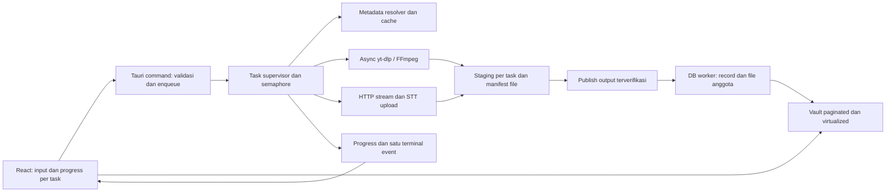

# Audit xDownloader — 12 Oktober 2026

## Kesimpulan

Stack Tauri + React + Rust + SQLite cocok untuk aplikasi ini. Hambatan terbesar berada pada lifecycle tugas, kepemilikan file, blocking I/O, dan render UI. Ada bug yang dapat menghapus file, membuat pembatalan tidak tuntas, dan menahan antrean. Perbaikan tersebut perlu didahulukan sebelum menambah paralelisme atau mengganti library.

Audit memakai working tree aktual, termasuk 14 file yang sudah memiliki perubahan lokal saat audit dimulai. Kode aplikasi tidak diubah. Laporan ini merupakan analisis sumber, pemeriksaan konfigurasi, build, dan tes yang tersedia; desktop tidak dijalankan dan unduhan platform/API berbayar tidak diuji secara langsung. Dampak waktu, CPU, dan RAM belum diukur pada aplikasi yang berjalan.

## Validasi yang dilakukan

| Pemeriksaan | Hasil |
| --- | --- |
| `bun test tests` | 70 lulus, 0 gagal; terdapat pesan EPERM ketika Bun mencoba membaca konfigurasi proyek induk di sandbox |
| `cargo test --lib --offline --locked` | 69 lulus, 0 gagal, 5 tes jaringan diabaikan |
| `bun run build` | TypeScript dan Vite berhasil; build Vite melaporkan 11,22 detik |
| Bundle utama | JavaScript 461,63 kB, gzip 124,99 kB; CSS 73,71 kB |
| Dry-run predikat cleanup | `my.film.mp4` dengan stem `my.film` diklasifikasikan sebagai fragmen yang boleh dihapus; tidak ada file yang dihapus dalam pemeriksaan ini |

Kelulusan tes belum membuktikan integritas download, cancel, output collision, dan antrean. Tes yang ada terutama meliputi utility/mock frontend, parser extractor, konfigurasi transkripsi, dan pembentuk subtitle.

Prioritas: **P1** = perlu diperbaiki sebelum rilis berikutnya karena integritas data, keamanan, atau lifecycle; **P2** = bug fungsional/performa yang perlu dijadwalkan. Keyakinan “tinggi” berarti penyebab terlihat langsung di kode; bukan klaim bahwa semua skenario telah direproduksi pada desktop.

## Temuan utama

### B01 — P1: tugas baru bisa menghapus file sementara tugas yang masih aktif

**Bukti:** [downloader.rs:258](D:/@dev/xclips/tools/xdownloader/src-tauri/src/downloader.rs:258) memanggil `sweep_orphaned_temp_files` setiap kali unduhan dimulai. [Predikat sweep](D:/@dev/xclips/tools/xdownloader/src-tauri/src/downloader.rs:149) menghapus `.part`, `.ytdl`, dan beberapa `.temp.*` tanpa memeriksa kepemilikan atau tugas aktif.

**Pemicu:** unduhan A dan B memakai folder output yang sama; B dimulai ketika A memiliki file sementara. Jika file tidak sedang terkunci oleh OS, B bisa menghapus file A. Pada Windows, file yang terkunci mungkin gagal dihapus, tetapi kegagalan ini diabaikan dan tidak menjamin keselamatan file lainnya.

**Perbaikan:** gunakan folder staging per `task_id` dan manifest file milik tugas. Bersihkan orphan saat startup/recovery berdasarkan status tugas, kepemilikan, dan usia file. Jangan menyapu folder output pengguna pada awal setiap unduhan. **Keyakinan: tinggi.**

### B02 — P1: cleanup bisa menghapus file final yang valid

**Bukti:** [downloader.rs:138](D:/@dev/xclips/tools/xdownloader/src-tauri/src/downloader.rs:138) menganggap setiap nama yang mengandung `.f` dan berakhiran MP4/M4A/WebM sebagai fragmen, selama cocok dengan stem. [Cleanup setelah validasi file](D:/@dev/xclips/tools/xdownloader/src-tauri/src/downloader.rs:935) dijalankan sebelum ukuran file disimpan.

**Contoh konkret:** custom name `my.film` menghasilkan `my.film.mp4`. Nama tersebut memenuhi predikat fragmen. Dry-run predikat mengembalikan `WouldDeleteFinalFile=True`.

**Dampak:** file yang baru berhasil diunduh dapat hilang, sementara tugas tetap ditandai completed dan ukurannya menjadi 0. Pencocokan stem dengan `contains` juga bisa mengenai tugas dengan nama beririsan.

**Perbaikan:** hapus hanya path sementara yang tercatat; selalu lindungi path final. Jika masih memakai pola nama, pola harus spesifik terhadap suffix format ID dan tugas. **Keyakinan: tinggi.**

### B03 — P1: fungsi download async memblokir worker runtime

**Bukti:** [downloader.rs:4](D:/@dev/xclips/tools/xdownloader/src-tauri/src/downloader.rs:4) memakai `std::process::Command`. [Loop stdout](D:/@dev/xclips/tools/xdownloader/src-tauri/src/downloader.rs:752), `BufRead::lines`, `child.wait`, dan `stderr_handle.join` berlangsung di dalam `run_download`, yang dipanggil melalui `tokio::spawn`.

**Dampak:** worker async tertahan selama unduhan. `tokio::spawn` tidak otomatis mengubah I/O sinkron menjadi nonblocking. Ini dapat menunda event, HTTP request, dan pembatalan, terutama saat banyak tugas/media berjalan.

**Perbaikan:** gunakan `tokio::process::Command`, async reader untuk stdout/stderr, dan `wait().await`. Tetapkan timeout dan jalur cancellation. Pindahkan kerja sinkron singkat seperti ZIP/SQLite ke worker terpisah. `spawn_blocking` tidak boleh menjadi satu-satunya mekanisme cancel karena pekerjaan yang sudah berjalan tidak dapat dihentikan hanya dengan abort. [Dokumentasi Tokio](https://docs.rs/tokio/latest/tokio/task/fn.spawn_blocking.html). **Keyakinan: tinggi; besarnya latensi perlu profiling.**

### B04 — P1: sebagian error tidak mengirim terminal event

**Bukti:** [lib.rs:80](D:/@dev/xclips/tools/xdownloader/src-tauri/src/lib.rs:80) mengabaikan hasil `run_download`. Beberapa error direct bundle, misalnya [HTTP failure](D:/@dev/xclips/tools/xdownloader/src-tauri/src/image_extractor.rs:1822), langsung `return Err` tanpa emit error. Jalur awal gagal menemukan binary/spawn juga tidak semuanya menyelesaikan event UI. Wrapper transkripsi mengabaikan hasil pipeline, sementara pembacaan respons, parsing JSON, dan penulisan subtitle memiliki jalur `?` tanpa event error.

**Dampak:** `start_download` sudah mengembalikan ID sehingga frontend menampilkan tugas aktif, tetapi tidak menerima completed/error untuk menghapus tugas dan meneruskan antrean.

**Perbaikan:** satu task supervisor menangani semua hasil, menulis status DB, mengirim satu terminal event, melepaskan permit, dan membersihkan registrasi. Detail pipeline boleh mengirim progress; terminal state menjadi tanggung jawab supervisor. **Keyakinan: tinggi.**

### B05 — P1: protokol cancellation tidak konsisten

**Bukti:** [cancel_download](D:/@dev/xclips/tools/xdownloader/src-tauri/src/lib.rs:108) hanya memanggil manager. Kode pembatalan tidak menulis status `cancelled`, meskipun [is_task_cancelled](D:/@dev/xclips/tools/xdownloader/src-tauri/src/db.rs:237) dipakai sebagai guard. [ProcessManager::remove](D:/@dev/xclips/tools/xdownloader/src-tauri/src/downloader.rs:58) menghapus PID dan abort handle sekaligus; pemanggilan setelah subprocess selesai juga menghilangkan kemampuan membatalkan sisa tahap pipeline.

Untuk file lokal, FFmpeg didaftarkan dengan [task_id asli](D:/@dev/xclips/tools/xdownloader/src-tauri/src/transcriber.rs:1160), sedangkan [cancel_transcription](D:/@dev/xclips/tools/xdownloader/src-tauri/src/lib.rs:277) mencoba membunuh `task_id_audio`. Men-abort task induk tidak menghentikan `spawn_blocking(child.wait())` yang sudah berjalan. Tidak ada shutdown handler khusus untuk membereskan child yang masih aktif saat aplikasi ditutup.

**Perbaikan:** cancellation token per tugas; registrasi child per tahap; matikan process tree, tunggu exit, bersihkan file milik tugas, lalu emit/persist cancelled. Pisahkan penghapusan child dari penghapusan tugas. Pada Windows, pertimbangkan Job Object untuk lifecycle process tree. `kill_on_drop` hanya membantu child langsung, bukan jaminan otomatis untuk seluruh turunannya. **Keyakinan: tinggi.**

### B06 — P1: nama output tidak memiliki perlindungan collision dan kepemilikan

**Bukti:** [template custom name](D:/@dev/xclips/tools/xdownloader/src-tauri/src/downloader.rs:450) tidak menyertakan task/media ID. Foto ditulis langsung ke [nama final](D:/@dev/xclips/tools/xdownloader/src-tauri/src/image_extractor.rs:1551). [Transkripsi URL](D:/@dev/xclips/tools/xdownloader/src-tauri/src/transcriber.rs:683) mengunduh audio ke folder output pengguna lalu [menghapus path audio](D:/@dev/xclips/tools/xdownloader/src-tauri/src/transcriber.rs:872).

**Pemicu:** dua media berbeda diberi nama sama; transkripsi memakai nama yang sudah memiliki MP3 di folder tersebut. Jika yt-dlp memakai kembali output lama, pipeline transkripsi dapat mengunggah dan kemudian menghapus MP3 yang sudah ada. Dua record juga dapat menunjuk file yang sama; delete satu record menghapus file milik record lainnya.

**Perbaikan:** staging per tugas, nama unik berbasis source ID/task ID, kebijakan overwrite eksplisit, dan publish tanpa menimpa diam-diam. Audio transkripsi harus berada di cache sementara milik tugas. Pisahkan operasi “hapus riwayat” dari “hapus file”. **Keyakinan: tinggi pada collision; skenario reuse MP3 perlu reproduksi yt-dlp.**

### B07 — P1: updater melewati verifikasi signature yang sudah tersedia

**Bukti:** [checkForAppUpdate](D:/@dev/xclips/tools/xdownloader/src/lib/tauri-api.ts:1360) mengembalikan hasil pengecekan GitHub native sebelum plugin signed updater digunakan. [Jalur instalasi](D:/@dev/xclips/tools/xdownloader/src/lib/tauri-api.ts:1459) mengirim URL ke [installer manual](D:/@dev/xclips/tools/xdownloader/src-tauri/src/lib.rs:311), yang mengunduh dan menjalankan EXE tanpa verifikasi signature aplikasi. Hasil `spawn` installer diabaikan sebelum aplikasi exit.

**Perbaikan:** jadikan plugin updater resmi jalur instalasi utama; gagal signature harus menghasilkan error. Jika perlu fallback manual, buka halaman rilis untuk instalasi oleh pengguna. Validasi hasil peluncuran installer sebelum exit. Plugin resmi mensyaratkan signature untuk memastikan asal update. [Tauri Updater](https://v2.tauri.app/plugin/updater/). **Keyakinan: tinggi; tidak ada klaim serangan telah terjadi.**

### B08 — P2: jalur bundle mengabaikan pilihan audio, quality, dan time range

**Bukti:** [interceptor media_items](D:/@dev/xclips/tools/xdownloader/src-tauri/src/downloader.rs:270) dan [Threads extraction](D:/@dev/xclips/tools/xdownloader/src-tauri/src/downloader.rs:363) masuk ke `download_media_bundle`, yang tidak menerima format/quality/time range.

**Dampak:** memilih audio untuk Threads atau mixed carousel dapat tetap menghasilkan video asli. Transkripsi Threads juga dapat mengunduh video lengkap karena ia memakai `run_download` dengan format audio. Ini menambah bandwidth dan membuat request dengan label MP3 tidak mencerminkan konten sebenarnya.

**Perbaikan:** pisahkan “resolve source items” dari “execute requested operation”; konversi audio dan trim harus dilakukan setelah source dipilih. Terapkan batas kualitas jika sumber menyediakan varian, atau jelaskan bahwa hanya kualitas sumber tersedia. **Keyakinan: tinggi.**

### B09 — P1: subtitle dapat dilaporkan berhasil meski publish gagal

**Bukti:** [transcriber.rs:1017](D:/@dev/xclips/tools/xdownloader/src-tauri/src/transcriber.rs:1017) mengabaikan hasil rename SRT/VTT/TXT, kemudian membuat record completed dan emit success. Jalur file lokal memakai pola serupa.

**Dampak:** collision, izin tulis, atau file terkunci dapat membuat output tidak terbit atau masih menunjuk subtitle lama. Fallback ukuran dari panjang string bukan bukti bahwa file tersimpan.

**Perbaikan:** propagate error rename/publish, gunakan temp name per task, validasi output yang dipublikasikan, lalu tulis record dan completed. Tentukan recovery jika hanya sebagian dari tiga format berhasil. **Keyakinan: tinggi.**

## Bug fungsional dan kekurangan tambahan

| ID / Prioritas | Temuan dan bukti | Perbaikan |
| --- | --- | --- |
| B10 / P2 | UI menawarkan 360p, tetapi [match backend](D:/@dev/xclips/tools/xdownloader/src-tauri/src/downloader.rs:659) tidak memiliki 360p sehingga masuk ke best. [Frontend](D:/@dev/xclips/tools/xdownloader/src/App.tsx:482) juga mengganti pilihan best dengan defaultVideoQuality. | Satu kontrak pilihan kualitas, case 360p, bedakan best dan default, dan jangan melanggar batas tinggi pada fallback. |
| B11 / P2 | Batas dua tugas hanya berada di [frontend](D:/@dev/xclips/tools/xdownloader/src/App.tsx:509). Slot belum dicadangkan sebelum `await startDownload`; metadata dan transkripsi tidak memiliki guard backend. Listener [effect kosong](D:/@dev/xclips/tools/xdownloader/src/App.tsx:227) memakai fungsi dequeue yang menangkap settings dari render awal. | Backend scheduler + semaphore dan snapshot seluruh opsi saat enqueue. UI membaca status antrean backend. Uji race start/complete/cancel. |
| B12 / P2 | `checkUpdatesOnStartup=false` tetap diikuti [startup check](D:/@dev/xclips/tools/xdownloader/src/App.tsx:173). `autoClipboardDetect` tidak diteruskan ke [UrlInputSection](D:/@dev/xclips/tools/xdownloader/src/components/UrlInputSection.tsx:21); polling tetap setiap detik. | Hubungkan pengaturan ke behavior; hentikan polling saat nonaktif atau aplikasi tidak terlihat; cegah request clipboard yang tumpang tindih. |
| B13 / P2 | Studio memiliki diarize/tagEvents/maxChars, tetapi [start request](D:/@dev/xclips/tools/xdownloader/src/components/TranscriptStudioModal.tsx:321) tidak mengirimnya. Request Studio juga tidak mengirim folder output pilihan pengguna. | Kirim options snapshot per tugas; backend menentukan effective settings tanpa mengubah global config untuk satu request. Simpan path hasil SRT untuk aksi Save. |
| B14 / P2 | [Timeout metadata](D:/@dev/xclips/tools/xdownloader/src-tauri/src/metadata.rs:69) membungkus `cmd.output()` tanpa kill_on_drop/kill explicit. Timeout future tidak menjamin child berhenti. | Pegang handle child, kill dan wait ketika timeout/cancel, lalu hapus registrasi. [Tokio process lifecycle](https://docs.rs/tokio/latest/tokio/process/struct.Command.html). |
| B15 / P2 | [initialSelectedIndices](D:/@dev/xclips/tools/xdownloader/src/components/MetadataPreviewCard.tsx:766) dibuat sebagai array baru. [Effect pemilihan](D:/@dev/xclips/tools/xdownloader/src/components/CarouselSelectionModal.tsx:29) mereset pilihan saat dependency tersebut berubah; progress tugas lain dapat memicu parent render. | Inisialisasi pada transisi modal dibuka atau perubahan post ID; stabilkan array turunan dengan useMemo. |
| B20 / P2 | [Delete DB](D:/@dev/xclips/tools/xdownloader/src-tauri/src/db.rs:353) menghapus satu file utama dan mengabaikan error unlink. Sibling carousel/BGM/VTT/TXT tidak tercatat sebagai file anggota. [Clean Vault](D:/@dev/xclips/tools/xdownloader/src/components/MediaVaultDrawer.tsx:79) dapat menganggap record downloading dengan path/ukuran kosong sebagai broken. | Tabel download_files, exclude active jobs dari purge, kebijakan delete jelas, dan recovery bila unlink gagal. Jangan menghapus record tugas yang masih aktif. |
| B21 / P2 | [Stored config](D:/@dev/xclips/tools/xdownloader/src-tauri/src/transcriber.rs:512) menyimpan API key sebagai JSON di SQLite. Masking UI sudah ada, tetapi tidak melindungi file DB. [CSP](D:/@dev/xclips/tools/xdownloader/src-tauri/tauri.conf.json:33) null dan asset scope seluruh filesystem. | Simpan key pada credential store OS; batasi scope asset ke folder yang dibutuhkan dan terapkan CSP sesuai media/platform. Ini hardening, bukan bukti kompromi. |
| B22 / P2 | Downloader foto menerima HTTP 200 dan bytes nonkosong lalu menamai file berdasarkan substring URL; tidak memeriksa MIME/jenis konten. Video bundle memakai timeout HTTP total 60 detik yang sama dengan scraping. | Tolak respons HTML/error, gunakan MIME dan pemeriksaan header konten sederhana, batas ukuran, dan client/timeout khusus untuk stream panjang. |

Keyakinan untuk tabel: tinggi pada wiring dan predikat kode; race scheduling, child orphan, dan kegagalan OS spesifik memerlukan tes runtime terkontrol.

## Bottleneck dan langkah optimasi

### B16 — P2: Vault melakukan query dan filesystem scan penuh

[get_records](D:/@dev/xclips/tools/xdownloader/src-tauri/src/db.rs:248) mengambil seluruh history tanpa pagination. Pemeriksaan `Path::exists` dan pencarian sibling carousel dilakukan saat mutex koneksi masih dipegang. WAL membantu SQLite, tetapi satu `Mutex<Connection>` tetap menserialkan semua operasi aplikasi. Riwayat besar atau folder output di disk/drive lambat dapat menunda read settings, logs, dan update tugas.

Terapkan keyset pagination `(created_at, id)` 50–100 item per halaman; ambil count/total ukuran dengan query agregat terpisah. Simpan daftar file anggota ketika download selesai. Pemeriksaan keberadaan file dilakukan di luar lock, pada item yang terlihat atau saat explicit refresh, dengan cache singkat. Jangan menjalankan scan filesystem per row pada setiap reload history. Transkripsi [memuat seluruh history untuk mencari satu audio record](D:/@dev/xclips/tools/xdownloader/src-tauri/src/transcriber.rs:770); ganti dengan query by ID.

Pertahankan rusqlite + WAL. Gunakan DB worker khusus/tokio-rusqlite jika ingin async API. Migrasi ke PostgreSQL atau SQLx tidak diperlukan untuk menyelesaikan masalah ini.

### B17 — P2: upload transkripsi menahan seluruh audio dan salinannya

[URL pipeline](D:/@dev/xclips/tools/xdownloader/src-tauri/src/transcriber.rs:790) dan [file pipeline](D:/@dev/xclips/tools/xdownloader/src-tauri/src/transcriber.rs:1214) membaca audio penuh ke Vec, kemudian menyalinnya ke Vec multipart. Saat body dibangun, payload audio dapat berada di memori dalam dua salinan, sebelum overhead kapasitas dan response.

Aktifkan multipart reqwest dan gunakan file stream/`Part::stream_with_length`. Untuk source non-MP3, evaluasi encoding audio yang sesuai untuk speech recognition berdasarkan uji akurasi; bitrate tertinggi untuk konsumsi musik tidak harus menjadi default STT. Pakai cache per tugas dan limit transkripsi berat. Streaming memperbaiki footprint RAM; kecepatan inference cloud tetap bergantung provider. [Reqwest multipart](https://docs.rs/reqwest/latest/reqwest/multipart/struct.Part.html).

### B18 — P2: progress memicu render UI dan history secara luas

[Event handler App](D:/@dev/xclips/tools/xdownloader/src/App.tsx:251) membuat Map baru setiap progress; state berada di root. [Vault tetap mounted](D:/@dev/xclips/tools/xdownloader/src/App.tsx:875) ketika tertutup, menghitung filter/total/broken records, lalu list/grid merender semua record. Throttle event backend 100–120 ms sudah membantu, tetapi tidak mengisolasi render komponen. Studio juga menampilkan semua subtitle cue dan memiliki listener yang bergantung pada callback `loadRecords` yang dibuat ulang setiap render.

Pisahkan store progress, subscribe per task ID, memoize row/history, dan buat callback stabil. Virtualisasi history dan cue list. Tahan pekerjaan history ketika drawer tertutup. Lazy-load modal besar saat pertama dibuka. Targetkan hanya row progress yang berubah. Batasi cache completed/failed task IDs dan rapikan listener yang baru selesai register setelah effect cleanup.

### B19 — P2: metadata diminta berulang dan loading bisa tertinggal

[handleUrlChange](D:/@dev/xclips/tools/xdownloader/src/App.tsx:330) langsung fetch. Smart Download dapat memanggil URL change dan start download pada aksi sama; [start download](D:/@dev/xclips/tools/xdownloader/src/App.tsx:439) fetch lagi sebelum metadata pertama selesai. Tidak ada deduplikasi in-flight atau cache. Mengganti URL valid ke kosong/tidak valid ketika request lama berjalan juga dapat meninggalkan `fetchingInfo=true`, karena finally hanya reset ketika URL masih sama.

Gunakan debounce sekitar 300 ms untuk input yang diketik, cache metadata berkapasitas terbatas dengan TTL, dan satu in-flight request per URL canonical. Gunakan sequence ID untuk loading/result/error; cancel child request yang sudah tidak relevan. TTL direct CDN URL perlu pendek karena token URL dapat kedaluwarsa. Routing extractor native dapat diprioritaskan untuk URL foto yang sudah pasti, agar tidak selalu menunggu yt-dlp gagal dahulu.

### B23 — P2: pekerjaan setup/logging dan carousel masih bisa dibuat lebih efisien

[Startup](D:/@dev/xclips/tools/xdownloader/src/App.tsx:149) menunggu pengecekan binary sebelum settings dan history; probe versi binary sinkron dan tidak memiliki timeout. [Installer binary](D:/@dev/xclips/tools/xdownloader/src-tauri/src/binaries.rs:268) melakukan write dan ekstraksi ZIP sinkron dalam async function. [Logger](D:/@dev/xclips/tools/xdownloader/src-tauri/src/logger.rs:47) membuka file dan mengecek rotasi setiap event; tabel task_logs tidak memiliki retention otomatis. Item carousel [diunduh berurutan](D:/@dev/xclips/tools/xdownloader/src-tauri/src/image_extractor.rs:1507), dan foto dibuffer penuh.

Muat settings/history/config dan probe binary secara independen; cache path/version binary dan invalidasi saat setup/update. Gunakan async buffered write untuk stream, worker terpisah untuk ZIP, staging atomic untuk binary, verifikasi integritas sebelum mengganti executable. Gunakan logger background dan retention log DB. Setelah B01/B06 dibenahi, uji paralelisme carousel terbatas 2–4 item, stream ke disk, dan backoff HTTP 429/503. Pool reqwest bersama pada image extractor sudah benar; jangan menggantinya dengan client baru per item.

`--concurrent-fragments 4` sudah dipakai. Opsi ini berlaku untuk fragmen DASH/HLS native, sehingga bukan jaminan percepatan semua URL HTTP atau “2–5x”. Tuning harus membandingkan throughput total, latensi UI, retry, dan rate limit. Gunakan `--progress-template`/`--progress-delta` agar parser tidak bergantung pada teks progress biasa yang dapat berubah. [Dokumentasi yt-dlp](https://github.com/yt-dlp/yt-dlp).

## B24 — P2: celah validasi dan dokumentasi

- [Tes real Threads](D:/@dev/xclips/tools/xdownloader/src-tauri/src/image_extractor.rs:2548) membaca fixture dari absolute path mesin pengembang. Jika file tidak terbaca, tes selesai tanpa assertion dan tetap lulus. Pindahkan fixture ke repository dan wajibkan pembacaan, misalnya `include_str!`.
- Tidak ada regression suite khusus lifecycle downloader/ProcessManager: cancel, cleanup, collision, terminal events, queue limits, dan disk failure.
- Workflow yang ditemukan hanya [release](D:/@dev/xclips/tools/xdownloader/.github/workflows/release.yml:1); tambahkan CI pada PR/push untuk frontend tests/build dan Rust tests. Gunakan lockfile frozen dan toolchain yang dipin untuk reproducibility.
- [README](D:/@dev/xclips/tools/xdownloader/README.md:20) mengklaim tidak ada media/metadata dikirim pihak ketiga, padahal STT mengunggah audio ke ElevenLabs dan beberapa extractor menggunakan API pihak ketiga. Nyatakan batas lokal/cloud yang aktual.
- Klaim splitter/trimmer lengkap dan presisi milidetik tidak didukung oleh command/komponen pada tree yang diaudit; parameter timeRange backend belum dihubungkan ke UI download aktif. Klaim RAM <60 MB dan percepatan 2–5x perlu hasil benchmark yang bisa diulang.

## Library yang cocok

Pilih sesuai masalah yang sedang diperbaiki, bukan memasang semuanya sekaligus. Periksa kompatibilitas versi dengan Cargo.lock/bun.lock; halaman dokumentasi terbaru bukan instruksi untuk upgrade major secara otomatis.

| Pilihan | Kegunaan spesifik | Catatan |
| --- | --- | --- |
| **Tokio yang sudah ada**: process, io, Semaphore | Async subprocess, batas tugas backend, stream stdout/stderr | Prioritas pertama; tidak perlu runtime tambahan. [Tokio process](https://docs.rs/tokio/latest/tokio/process/struct.Command.html). |
| **tokio-util** | CancellationToken dan ReaderStream | Cancel kooperatif dan stream upload; tetap perlu child kill/wait dan cleanup. [CancellationToken](https://docs.rs/tokio-util/latest/tokio_util/sync/struct.CancellationToken.html). |
| **reqwest yang sudah ada**, tambah multipart | Streaming upload audio, HTTP pooling | Hindari multipart Vec manual. Pool reuse mengurangi setup koneksi. [Part](https://docs.rs/reqwest/latest/reqwest/multipart/struct.Part.html), [Client](https://docs.rs/reqwest/latest/reqwest/struct.Client.html). |
| **tokio-rusqlite** atau DB actor kecil | Menjalankan rusqlite di dedicated worker | Cocok setelah query/pagination dibenahi; pin versi rusqlite yang kompatibel. [Dokumentasi](https://docs.rs/tokio-rusqlite/latest/tokio_rusqlite/). |
| **Zustand** | Progress store dan selector per task/row | Subscribe ke slice kecil; tetap butuh desain selector dan callback stabil. [Panduan resmi](https://github.com/pmndrs/zustand/blob/main/docs/learn/guides/beginner-typescript.md). |
| **@tanstack/react-virtual** | Virtualisasi Vault dan subtitle cues | Cocok dengan Tailwind karena tidak menentukan markup/styles. [Dokumentasi](https://tanstack.com/virtual/latest/docs/introduction?from=reactVirtualV2). |
| **moka**, opsional | Cache metadata dengan TTL dan deduplikasi pemuatan | Untuk kebutuhan sederhana, Map berkapasitas terbatas cukup. [Cache](https://docs.rs/moka/latest/moka/future/struct.Cache.html). |
| **tracing + tracing-subscriber + tracing-appender** | Timing pipeline, structured logs, writer background | Tetapkan buffer/retention dan simpan WorkerGuard. [Nonblocking writer](https://docs.rs/tracing-appender/latest/tracing_appender/non_blocking/index.html). |
| **tauri-plugin-updater yang sudah ada** | Instalasi update terverifikasi | Utamakan jalur ini dan hentikan fallback install unsigned. [Tauri Updater](https://v2.tauri.app/plugin/updater/). |
| **keyring-core + windows-native-keyring-store** | Simpan key di Windows Credential Manager | Migrasi key lama secara aman; pilih persistence yang sesuai portable mode. [Store Windows](https://docs.rs/windows-native-keyring-store/latest/windows_native_keyring_store/). |
| **specta + tauri-specta**, opsional | Generate model/command binding TS dari Rust | Pilih rilis yang mendukung Tauri 2; mengurangi drift tipe, tidak menggantikan validasi input runtime. [Repository resmi](https://github.com/specta-rs/tauri-specta). |
| **scraper / semver**, bila dibutuhkan | Parser HTML lebih terstruktur / perbandingan versi standar | Gunakan scraper untuk bagian HTML; pertahankan serde_json untuk embedded JSON. Semver menghindari parser versi buatan yang mengabaikan prerelease. [scraper](https://docs.rs/scraper/latest/scraper/), [semver](https://docs.rs/semver/latest/semver/struct.Version.html). |

React.lazy, useMemo, useCallback, std::sync::LazyLock untuk regex, async filesystem, dan Semaphore sudah tersedia lewat dependensi/standard library. Optimasi ini dapat dikerjakan sebelum menambah library. Electron, browser automation untuk semua extractor, database server, dan external downloader tambahan tidak menjadi pilihan awal karena menambah runtime/operasional tanpa menyelesaikan temuan inti.

## Arsitektur sasaran

Task supervisor memiliki tanggung jawab register, cancel, error, release slot, dan recovery. Resolver hanya menentukan sumber media; format/quality/trim diproses oleh execution stage. Completed baru terbit sesudah output dan record berhasil disimpan. Cleanup beroperasi atas manifest, bukan pencarian substring nama.

## Urutan implementasi dan kriteria selesai

1. **Integritas file:** B01/B02/B06/B09/B20. Dua download ke folder yang sama tidak saling menghapus; judul `my.film` aman; tabrakan nama memiliki kebijakan jelas; cancel/error hanya membersihkan file tugas sendiri.
2. **Lifecycle dan scheduler:** B03/B04/B05/B11/B14. Semua tugas memiliki satu terminal state; tidak ada child berjalan setelah cancel/exit; jumlah tugas tidak melebihi permit backend; antrean lanjut setelah error.
3. **Ketepatan fungsi dan update:** B07/B08/B10/B12/B13/B15. Resolusi/format/opsi Studio benar; preference benar-benar mengendalikan behavior; pilihan carousel bertahan saat progress tugas lain; signature gagal tidak diikuti installer manual.
4. **Performa:** B16–B19/B23. Pagination + virtualization, streaming upload, metadata dedupe, progress store, dan startup paralel. Tambahkan concurrency carousel hanya setelah kepemilikan file aman.
5. **Validasi dan dokumentasi:** B21/B22/B24. CI, fixture reproducible, credential storage, validasi media, dokumentasi lokal/cloud, dan benchmark.

Benchmark harus memakai dataset dan koneksi yang sama: history 100/1.000/10.000 record; 1/2/4 tugas; audio 50/250/500 MB; cold/warm metadata; carousel kecil/besar; output di SSD dan drive lambat. Ukur startup-to-interactive, metadata p50/p95, Vault first-page p95, peak RAM gabungan aplikasi/WebView/child, CPU idle, throughput total, dan latency cancel-to-process-exit. Catat mode dev/release dan kondisi cache. Sasaran yang perlu diuji: loading halaman Vault tidak bertambah linear terhadap seluruh history; upload tidak membutuhkan dua buffer sebesar file; progress satu tugas tidak merender seluruh history; cancellation tidak meninggalkan proses atau file yang tidak tercatat.

Tidak ada persentase percepatan yang dijanjikan dalam audit ini. Prioritas performa ditentukan oleh bukti struktur kode; angka manfaat baru dapat dinyatakan setelah pengukuran sebelum/sesudah.
